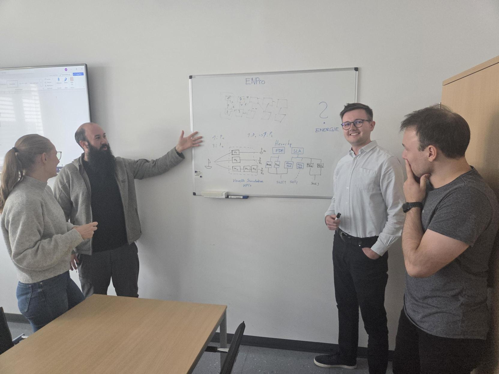

Passend zum Start des neuen Studienjahres ist auch bei ENPro frischer Schwung eingekehrt: Am **Montag, 12. Oktober 2026**, trafen sich die Kolleginnen und Kollegen der Standorte **Hagenberg und Wels** am **FH OÖ Campus Hagenberg** zum Kickoff von **Arbeitspaket 4 (AP4)**.

<!--more-->

In AP4 werden die Ergebnisse der bisherigen Forschungsbereiche zu einem **Gesamtsystem** zusammengeführt, mit dem sich der Energieverbrauch in der Produktion berechnen und gezielt optimieren lässt. Dabei spielen auch die Wahl der Materialien und die Gestaltung der Produktionsprozesse eine Rolle.

Im Rahmen eines gemeinsamen Workshops tauschten sich die Teams über ihre Sichtweisen und Anforderungen aus und schufen ein **gemeinsames Verständnis** als Grundlage für die weitere Zusammenarbeit. Darauf aufbauend arbeiten wir bereits an einem ersten Optimierungsansatz, der zunächst an einem bewusst allgemein gehaltenen, akademischen Anwendungsfall erprobt wird.

Am Ende dieses Weges soll ein Demonstrator stehen, der **„ENPro Showcase“**: ein interaktives, vernetztes *Big Picture*, das die Ergebnisse der einzelnen Forschungsbereiche zusammenführt und ihre Zusammenhänge anschaulich macht.

Wir halten euch auf dem Laufenden!

 

   