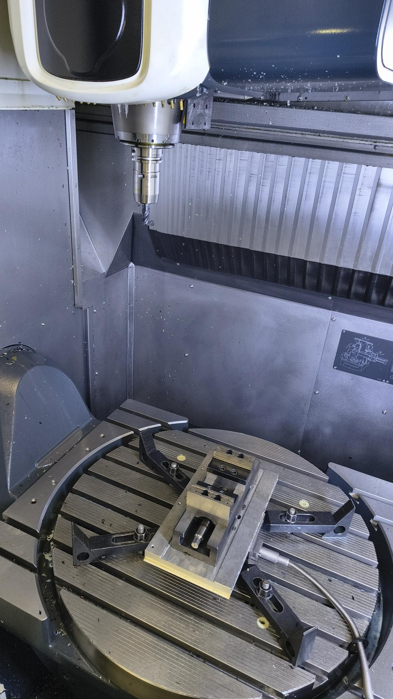
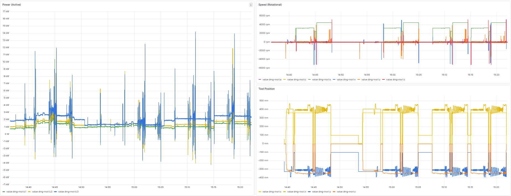
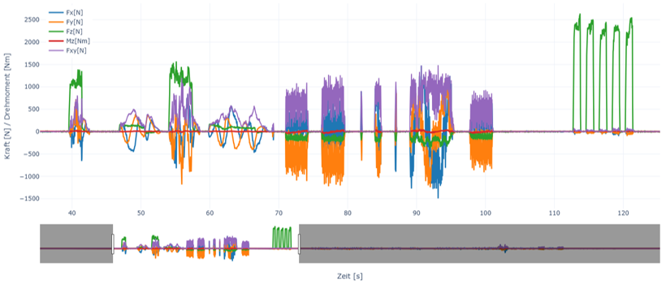
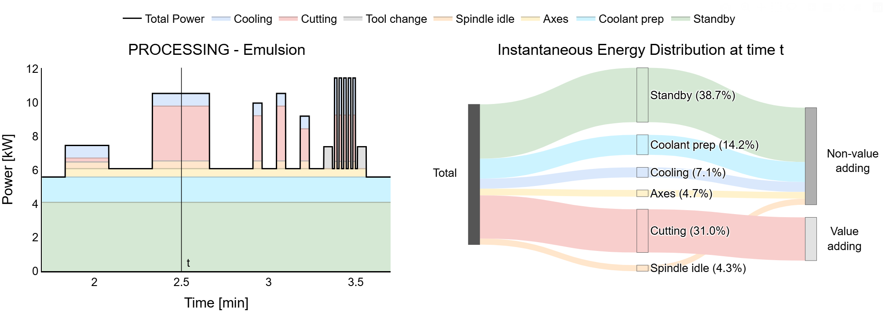

**Wie viel Energie benötigt eigentlich ein Bearbeitungszentrum? Und wie viel davon wird tatsächlich für die Zerspanung eines Bauteils aufgewendet?** Mit genau diesen Fragen beschäftigen wir uns derzeit am Standort Wels im Rahmen des ENPro-Projekts. Unser Ziel ist es, den Energiebedarf von Fertigungsprozessen besser zu verstehen und damit die Grundlage für eine **energieeffizientere Produktion** zu schaffen.

<!--more-->

Dazu untersuchen wir Fräsprozesse auf einer **DMG MORI LASERTEC 65 3D**. Der Versuchsaufbau umfasst eine Kraftmessplattform zur Erfassung der während der Bearbeitung auftretenden Kräfte, ein Energiemesssystem zur Aufzeichnung der elektrischen Leistungsaufnahme der Maschine sowie einen Durchflusssensor zur Bestimmung des Druckluftverbrauchs.

Darüber hinaus vergleichen wir verschiedene Kühlschmierstrategien, darunter **Druckluftkühlung, Emulsionskühlung, Minimalmengenschmierung und Kaltluftkühlung**.

  

Um den Einfluss unterschiedlicher Prozessbedingungen zu untersuchen, führen wir Fräsversuche mit verschiedenen **Stahlwerkstoffen und Bearbeitungsparametern** durch. Dabei interessieren uns nicht nur die Prozesskräfte, sondern auch folgende Fragen:

- **Wie hoch ist der elektrische Energieverbrauch der Maschine?**
- **Welchen zusätzlichen Energiebedarf verursacht die Bereitstellung der Druckluft?**
- **Welchen Einfluss haben unterschiedliche Kühlschmierstrategien auf den Gesamtenergiebedarf?**

  

Die gewonnenen Messdaten liefern wertvolle Einblicke in die **Energieflüsse innerhalb des Bearbeitungsprozesses**. Besonders spannend ist jedoch die Frage, ob sich diese Zusammenhänge auch mathematisch beschreiben lassen.

Genau daran arbeiten wir im ENPro-Projekt. Durch die Verknüpfung von Prozesskräften, Energieverbrauch und weiteren Einflussgrößen entwickeln wir **physikalisch basierte Modelle**, die transparent machen, wohin die eingesetzte Energie während eines Fräsprozesses fließt.

Unser Ziel ist es, dieses Wissen praxisnah nutzbar zu machen und Unternehmen dabei zu unterstützen, den Energiebedarf ihrer Fertigungsprozesse künftig bereits **in der Planungsphase zu berücksichtigen**.

  

**Neugierig auf die Ergebnisse?** Wir arbeiten derzeit noch an der Auswertung der Versuche und der Aufbereitung der Ergebnisse. Unsere bisherigen Arbeiten zur mathematischen Modellierung des Energieverbrauchs in Zerspanungsprozessen bieten jedoch bereits interessante Einblicke.

Weitere Informationen dazu finden sich in unserer Publikation:

[Zur Publikation: Mathematische Modellierung des Energieverbrauchs in Zerspanungsprozessen](https://easychair.org/publications/preprint/5BjN/open)

  

