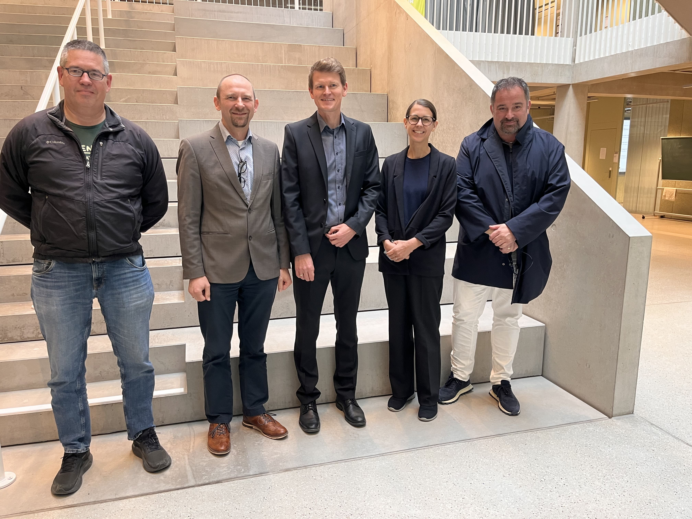
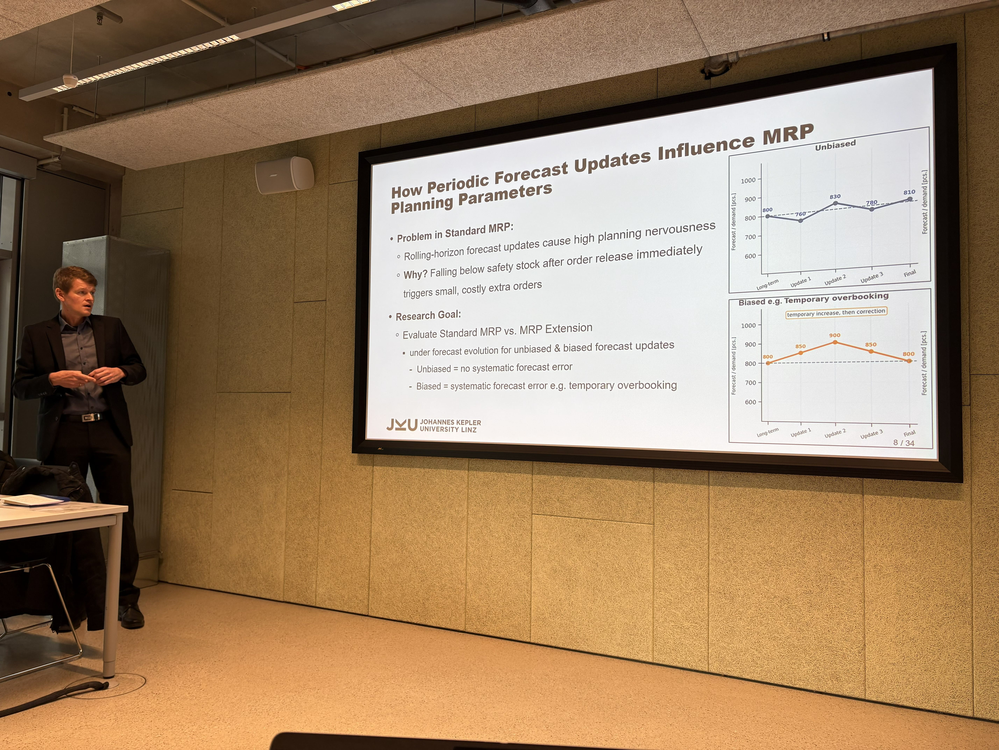
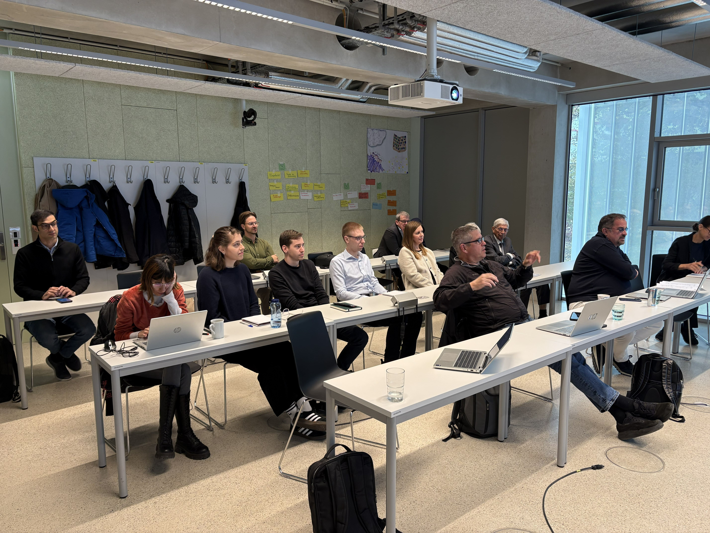
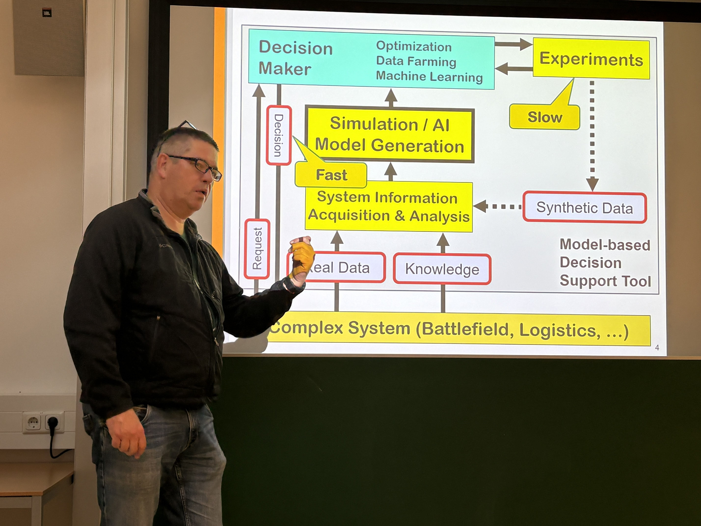

Am 6. November 2026 verteidigte **Wolfgang Seiringer** erfolgreich seine Dissertation an der JKU Linz. Seine Arbeit beschäftigt sich mit der Weiterentwicklung der Materialbedarfsplanung unter begrenzten Kapazitäten sowie Unsicherheiten hinsichtlich Nachfrage und Produktionsabläufen mithilfe von Simulation und Optimierung. Die Arbeit entstand im Forschungsumfeld von ENPro und leistet einen Beitrag zu den dort behandelten Fragestellungen zur Simulation von Produktionssystemen.

<!--more-->

Die Dissertation wurde von Prof. Klaus Altendorfer (FH Oberösterreich) als Erstbetreuer und Prof. Sophie Parragh (JKU Linz) als Zweitbetreuerin begleitet. Dem Prüfungssenat gehörten neben Prof. Sophie Parragh auch Prof. Michael Affenzeller (FH Oberösterreich) und der externe Gutachter Prof. Oliver Rose (Universität der Bundeswehr München) an.

Bereits am Vortag gab Prof. Oliver Rose im Rahmen eines Gastvortrags Einblicke in die simulationsbasierte Entscheidungsunterstützung für militärische und industrielle Fragestellungen.

Herzliche Gratulation an Wolfgang Seiringer zur erfolgreichen Promotion!

 
   
   
   
   
