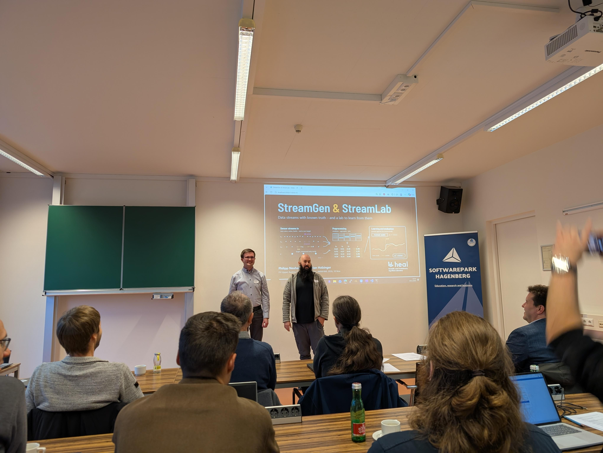

Wie lässt sich der Energiebedarf pro Werkstück vorhersagen, wenn eine Maschine laufend Sensordaten liefert, der tatsächliche Verbrauch aber nur selten gemessen wird? Beim **Austrian Workshop on Metaheuristics and Machine Learning (AWMHML 2026)** der ÖGOR stellten **Philipp Neuhauser und Florian Holzinger** am 10. November am FH OÖ Campus Hagenberg zwei Werkzeuge aus dem ENPro-Projekt vor, mit denen sie dieser Frage nachgehen.

<!--more-->

Nachdem Stefan Wagner im Vorjahr an der TU Wien das Projekt ENPro vorgestellt hatte, gab das Hagenberger Team heuer Einblick in die Arbeit mit **StreamGen** und **StreamLab**. Mit StreamGen lassen sich die Datenströme einer Maschine nachbilden. Ein Beispiel aus ENPro ist ein 3D-Drucker, dessen elektrische Leistungsaufnahme anhand eines physikalischen Modells berechnet wird. Im simulierten Datenstrom können einzelne Messwerte verspätet eintreffen oder ganz ausfallen. Die ursprünglich berechneten Werte bleiben für den späteren Vergleich erhalten.

Wie sich solche Lücken auf eine Vorhersage auswirken, lässt sich mit **StreamLab** untersuchen. Das Werkzeug fasst die unterschiedlich häufig erfassten Sensordaten in Zeitfenstern zusammen und ordnet sie den Verbrauchsmessungen zu. Die beiden Forscher zeigten, warum die Wahl des Zeitfensters wichtig ist. Reicht es über den Zeitpunkt der Verbrauchsmessung hinaus, fließen bereits Sensorwerte ein, die bei einer Vorhersage noch gar nicht vorliegen würden. Mit den Referenzdaten aus StreamGen lässt sich prüfen, welche Messwerte tatsächlich zum jeweiligen Zeitfenster gehören und wie sich die Zuordnung auf den Vorhersagefehler auswirkt.

Als nächsten Schritt plant das Team, physikalisches Vorwissen auch beim Lernen der Modelle einzusetzen. Mithilfe **symbolischer Regression** sollen so nachvollziehbare Formeln entstehen, die bekannte Zusammenhänge mit den Erkenntnissen aus den Sensordaten verbinden.

